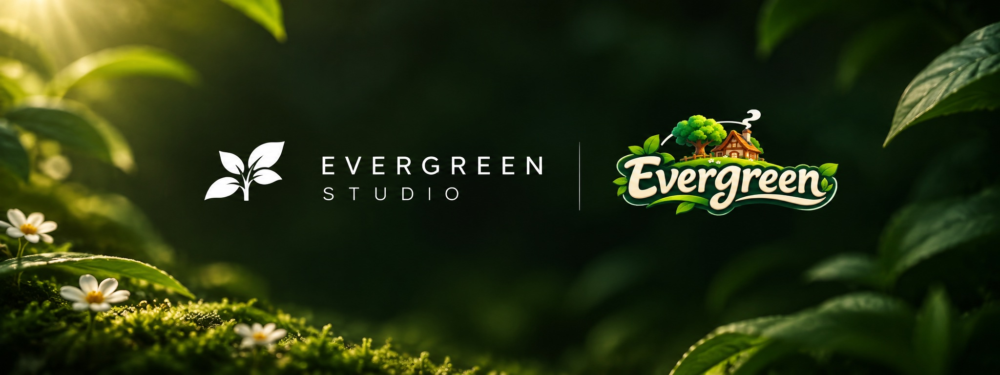

  

<h1 align="center">EVERGREEN</h1>

  <b>Zbuduj swoje życie. Znajdź swoich ludzi. Uczyń to domem.</b>

  
  
  
  

---

## Witaj w świecie, do którego chce się wracać

Wyobraź sobie miejsce, w którym czas płynie wolniej. Rano podlewasz grządki, po południu łowisz ryby nad spokojną zatoką, a wieczorem siadasz przy ognisku z przyjaciółmi.

**EVERGREEN** to cozy life sim w 3D, w którym to ty decydujesz, jak wygląda twoje życie. Nie ma wyścigu o ekwipunek, nie ma rankingów, nie ma listy obowiązków. Możesz zniknąć na tydzień, a twój dom, twoje plony i twoi znajomi będą na ciebie czekać.

## Co na ciebie czeka

| | |
| :---: | --- |
| 🌿 | **Wolny wybór życia.** Farma to tylko jedna z wielu dróg. Wybierz rzemiosło, handel albo po prostu włóczęgę po okolicy. |
| 🏡 | **Twój dom, twoje zasady.** Buduj, projektuj i urządzaj przestrzeń tak, jak lubisz. |
| 🤝 | **Ludzie, z którymi warto żyć.** Odwiedzaj sąsiadów, pomagaj znajomym, twórz wspólne historie w dużym, wspólnym świecie. |
| 🗺️ | **Odkrywaj.** Każdy zakątek skrywa sekrety, które czekają, aż je znajdziesz. |
| 🧺 | **Handel i rzemiosło.** Każdy ma swoje miejsce w gospodarce, a współpraca się opłaca. |
| ☕ | **Spokój bez presji.** Bez codziennych zadań, bez kar za nieobecność, bez pośpiechu. |

## Dlaczego EVERGREEN

- **Bez presji.** Gra nie karze za przerwę. Farma nie zwiędnie, kiedy wyjedziesz na weekend.
- **Bez płatnej przewagi.** Kosmetyki i waluta za prawdziwe pieniądze nie dają przewagi. Liczy się to, co zbudujesz własnymi rękami.
- **Razem albo osobno.** Współpraca przynosi radość i wygodę, ale nigdy nie jest warunkiem postępu.

## Kiedy i gdzie

EVERGREEN ukaże się na **Steamie**. Pierwsza wersja zostanie wydana na **macOS** (Apple silicon), a wsparcie dla innych platform jest w planach. Premiera jeszcze nie ma daty. Jak tylko ją ustalimy, pojawi się tutaj.

---

  
   
  © EVERGREEN. Wszelkie prawa zastrzeżone.

